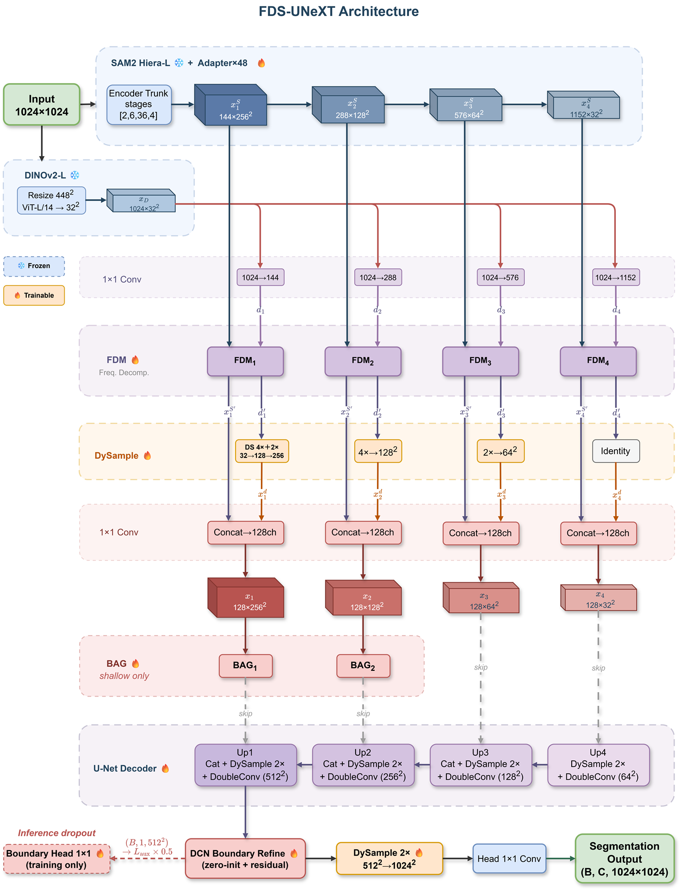

# FDS-UNeXT

Code for the paper **"Boundary-Aware Adaptation of Frozen Foundation Models for
Fine-Grained Rooftop Segmentation"** (submitted to *Remote Sensing*).

FDS-UNeXT turns two frozen foundation models, the SAM 2.1 Hiera-L image encoder
and DINOv2 ViT-L/14, into a four-class rooftop material segmenter with 6.97 M
trainable parameters (1.33 % of the 523.1 M total). On the Lanzhou Rooftop
Material Dataset (LRMD, 0.14 m GSD) it reaches 70.00 % mIoU and 72.92 %
boundary F-score.



*Architecture. Snowflake markers denote frozen parameters and flame markers
trainable ones: the two trunks stay frozen, while the 48 Hiera adapters, the
four FDM blocks, the DySample units, the two boundary attention gates, the
U-Net decoder, the deformable-convolution refinement, and the segmentation head
are trained.*

The four components that carry the result:

| Component | Module | What it replaces / adds |
|---|---|---|
| Frequency-decoupling module (FDM) | `models/fdm.py` | Replaces the dense glue layer between the two encoders with an invertible Haar DWT/IWT pair, an SE recalibration of the low-frequency band, and a zero-initialized gate that injects the high-frequency bands of the SAM stream into the DINOv2 stream. |
| DySample | `models/dysample.py` | Replaces every bilinear upsampling in the decoder with content-aware resampling (zero-initialized offset and scope heads, bounded offsets `T·tanh(o/T)`). |
| Boundary supervision | `models/boundary_modules.py` | A boundary attention gate on the shallow skips (fixed Sobel branch × learned attention), a training-only auxiliary boundary head on 3-px bands, and a deformable-convolution refinement before the final upsampling. |
| Combined loss | `losses/combined_loss.py` | Class-balanced BCE (k = 7) + IoU + SDF boundary term, with an uncertainty-weighted multi-task balance and a Dice-epoch gate. |

## Repository layout

```
models/          FDS-UNeXT, FDM, DySample, boundary modules, the SAM2-UNeXT
                 reference model, and the U-Net++/UNetFormer baselines
losses/          combined loss (BCE + IoU + SDF, uncertainty weighting)
utils/           dataset split, augmentation (Mosaic-9, copy-paste, resolution
                 perturbation, flips), metrics (mIoU, boundary F-score), SDF
datasets.py      torch Dataset and the train/test transforms
train.py         five-fold training, checkpoint selection on validation mIoU
eval.py          test-set evaluation (mIoU, per-class IoU, boundary F-score)
train_compare.py comparators (U-Net, U-Net++, Attention U-Net, DeepLabV3+,
                 SegFormer-B2, HRNet-W32, UNetFormer-R18)
eval_ref.py      evaluation of the official SAM2-UNeXT baseline
tools/           boundary IoU / HD95, throughput, qualitative and error maps
sam2/, sam2_configs/   minimal vendored SAM 2 package (Apache-2.0)
assets/          architecture figure shown above
```

## Installation

```bash
conda create -n fds-unext python=3.10 -y
conda activate fds-unext
pip install torch torchvision --index-url https://download.pytorch.org/whl/cu121
pip install -r requirements.txt
```

Download the two frozen trunks and place them in `weights/`:

```bash
mkdir -p weights
# SAM 2.1 Hiera-L (Meta, Apache-2.0)
wget -P weights https://dl.fbaipublicfiles.com/segment_anything_2/092824/sam2.1_hiera_large.pt
# DINOv2 ViT-L/14 (Meta, Apache-2.0)
wget -P weights https://dl.fbaipublicfiles.com/dinov2/dinov2_vitl14/dinov2_vitl14_pretrain.pth
```

Check the official repositories for the current file names before downloading.
Only the two trunks are loaded; no pretrained segmentation head is used.

## Data

**LRMD is not redistributed.** The imagery comes from a public web mapping
service whose terms do not allow redistribution, so this repository ships code
and split definitions only. The four labels are

| value | class | albedo prior |
|---|---|---|
| 0 | background (concrete roofs, asphalt, soil, vegetation, roads, water, vehicles) | — |
| 1 | high-albedo color-coated steel | 0.30–0.75 |
| 2 | low-albedo color-coated steel | 0.05–0.20 |
| 3 | tile | 0.10–0.35 |

Annotation follows a written protocol; a condensed English version is provided
in Section S10 of the supplementary material of the paper.

Expected layout (any root works):

```
dataset/roof_dataset_v2/
  images/            1024x1024 RGB PNG tiles
  masks/             single-channel PNG, values 0-3 (255 = ignore)
  split_fold0.json   written by train.py when --split_path does not exist
  ...
```

Each `split_fold*.json` holds `train`/`val`/`test` lists of absolute or relative
paths. To rebuild a five-fold, scene-disjoint split, pass a regular expression
for the scene identifier to `train.py` through `--group_pattern`; tiles sharing
a captured group are kept on the same side of every fold.

The two transfer datasets (ISPRS Potsdam at 5 cm and E-GCS at 0.3 m) are public
and are not bundled either. Potsdam is prepared in two steps:
`tools/prepare_potsdam_labels.py` converts the six-class RGB label tiles to
index masks, and `tools/prepare_potsdam_crops.py` cuts 36 anchored 1024-px tiles
per scene and writes a scene-disjoint split. The blur-degradation control of the
supplementary material is generated by `tools/make_potsdam_blur.py`.

## Training

The protocol reported in the paper, for fold *k* of LRMD:

```bash
python train.py \
  --hiera_path weights/sam2.1_hiera_large.pt \
  --dinov2_path weights/dinov2_vitl14_pretrain.pth \
  --train_image_path dataset/roof_dataset_v2/images \
  --train_mask_path  dataset/roof_dataset_v2/masks \
  --split_path       dataset/roof_dataset_v2/split_fold${k}.json \
  --save_path        runs/fold${k} \
  --epoch 100 --batch_size 2 --lr 3e-5 --weight_decay 5e-4 \
  --num_classes 4 --seed 42 \
  --warmup_epochs 10 --mosaic_close_epochs 50 --dy_edge_offset 6 \
  --num_workers 8
```

Two checkpoints are written per run: `FDS-UNeXT-best.pth` (selected on
validation mIoU, used for every number in the paper) and
`FDS-UNeXT-best-bf.pth` (selected on validation boundary F-score).

The defaults of `train.py` are those of the codebase, not those of the paper
(40 epochs, learning rate 2e-4, `warmup_epochs 0`, `mosaic_close_epochs 10`,
`dy_edge_offset 4`). Always pass the flags above when reproducing the paper.

## Evaluation

```bash
python eval.py \
  --hiera_path weights/sam2.1_hiera_large.pt \
  --dinov2_path weights/dinov2_vitl14_pretrain.pth \
  --checkpoint runs/fold${k}/FDS-UNeXT-best.pth \
  --split_path dataset/roof_dataset_v2/split_fold${k}.json --split test \
  --num_classes 4 --bf_tolerance 8 --dy_edge_offset 6 \
  --class_names background,high-albedo-steel,low-albedo-steel,tile
```

The paper reports the boundary F-score with an **8-pixel tolerance**, which is
not the default of `eval.py` (2 px). Boundary IoU, HD95 and the penalized HD95
variant come from `tools/b2_boundary_metrics.py` with `--group roof_fds`.

## Reproducing the tables and figures

| Paper item | How |
|---|---|
| Table of per-fold LRMD scores | `train.py` + `eval.py` per fold, aggregate the `test_metrics.json` files |
| Comparator table | `train_compare.py --model <name> --split_path ...` (it trains and evaluates in one run; boundary F-score tolerance is 8 px by default here) |
| Official SAM2-UNeXT baseline | `train_ref.py` and `eval_ref.py` (GroupNorm instead of BatchNorm, K-class head, bounded residual adapter) |
| Module ablation (Table 5) | `train.py` with `--no-use_fdm`, `--no-use_dysample`, `--no-use_ba`, `--no-use_boundary_head`, `--no-use_dcn`, each over five folds |
| Tanh-bound ablation | `train_notanh.py` and `eval_notanh.py`, which build `models/fds_unext_notanh.py` (unbounded adapter residual) |
| Boundary IoU / HD95 (Table 6) | `tools/b2_boundary_metrics.py` |
| Throughput spectrum (Figure 8) | `tools/a1_efficiency.py` |
| Qualitative and error maps | `tools/a2_qualitative.py`, `tools/a3_representative.py` |

`results/run_summary.csv` aggregates every run behind the paper (validation and
test mIoU / boundary F-score per fold, run name, and which log the numbers were
taken from).

## Implementation notes

* **Mixed precision.** In the version used for the paper, the autocast context
  was enabled whenever a gradient scaler object existed, so all runs executed
  the forward pass in float16 even with `--amp False`. The flag is kept for
  compatibility; see §3.5.2 of the paper for the disclosure and the measured
  effect (about 0.36 mIoU below a float32 evaluation of the same checkpoints).
* **Photometric gain.** `--photo_metric` and `--photo_gain` are implemented but
  disabled in every run reported in the paper, because the high-/low-albedo
  distinction is itself photometric.
* **MLP head.** `--use_mlp_head` is off by default and off in the paper; the
  fusion head remains in the code as an optional variant.
* **Bounded adapter.** The residual adapter of the SAM branch uses a `tanh`
  bound. The unbounded variant reported in the supplementary material is
  produced by `train_notanh.py`, which instantiates
  `models/fds_unext_notanh.py`.
* **Class absent from the ground truth.** Metrics skip a class that does not
  appear in the reference tile, following the convention of `utils/metrics.py`.

## License

Apache-2.0; see [LICENSE](LICENSE). The vendored `sam2/` package and the two
frozen trunks come from Meta AI and are distributed under the same license; see
[THIRD_PARTY_NOTICES.md](THIRD_PARTY_NOTICES.md).

## Citation

```bibtex
@article{zhao2026fdsunext,
  title   = {Boundary-Aware Adaptation of Frozen Foundation Models for
             Fine-Grained Rooftop Segmentation},
  author  = {Zhao, Yuancheng and Wang, Jie and Li, Faguo and Liu, Erte and
             Meng, Xiangying and Chen, Yueyue},
  journal = {Remote Sensing},
  year    = {2026},
  note    = {Under review}
}
```

## Acknowledgements

The SAM 2 implementation is adapted from
[facebookresearch/sam2](https://github.com/facebookresearch/sam2); the decoder
follows SAM2-UNeXT. The computations were performed on the Supercomputing
Center of Lanzhou University.
